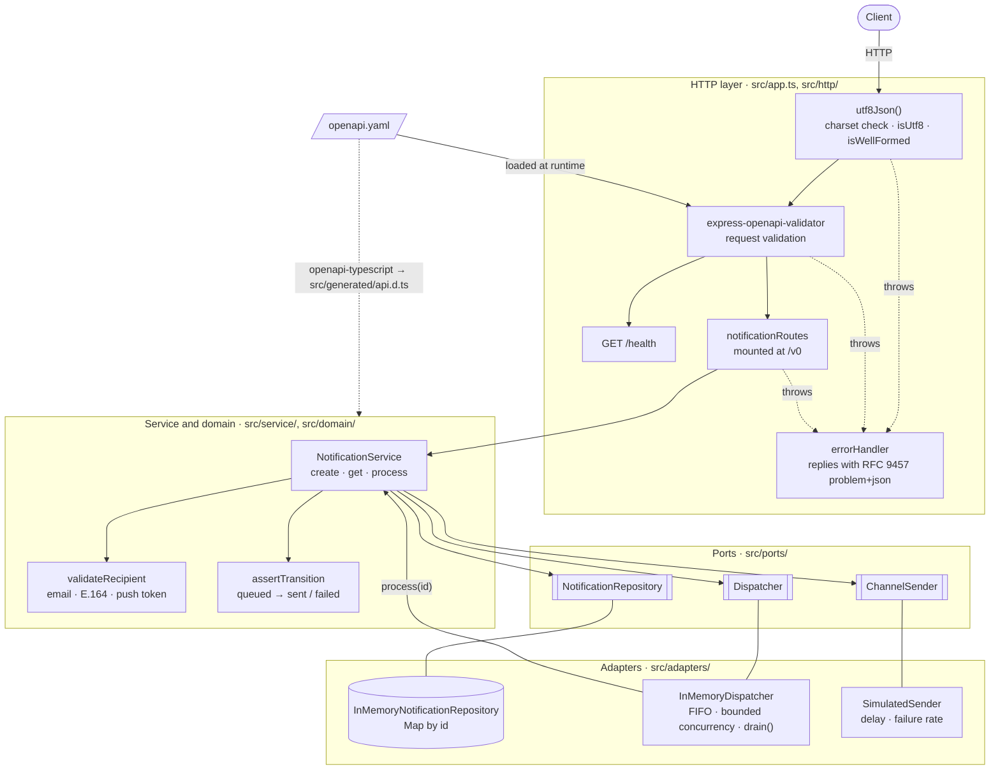
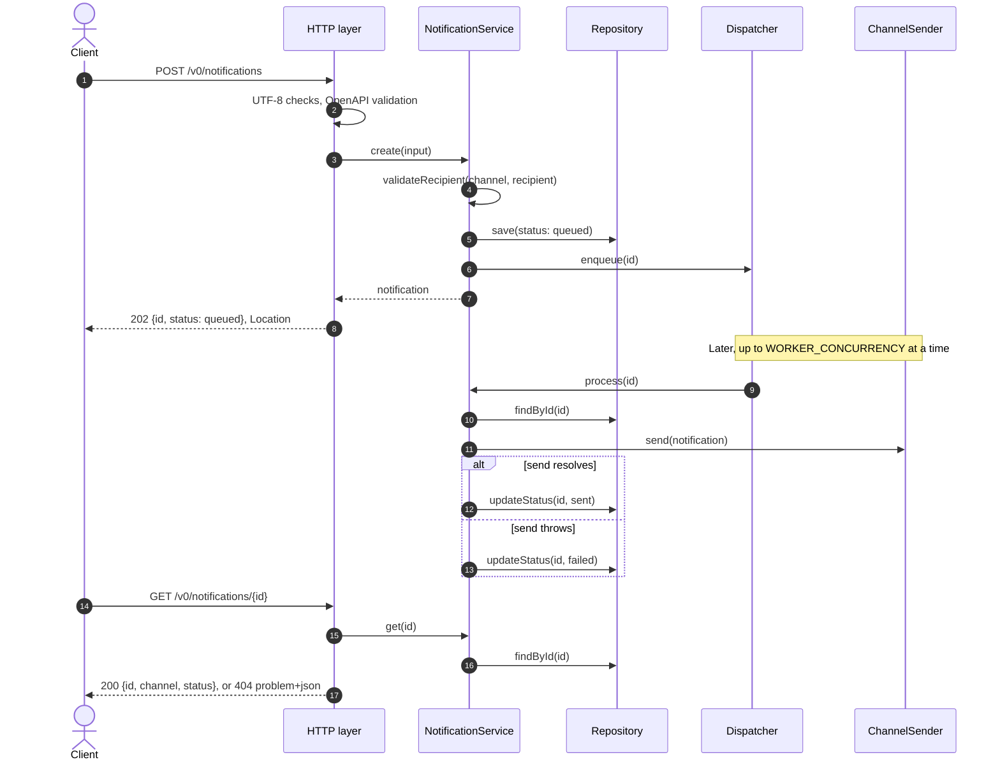
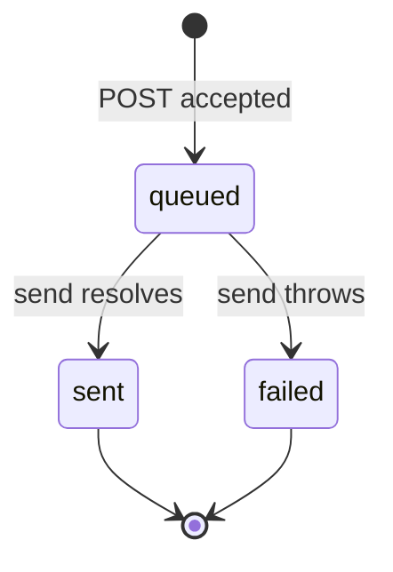

# Architecture

The diagrams are Mermaid, which GitHub renders inline. They describe the code as it is; file names link to the source.

## Components

Requests pass through a fixed middleware chain before reaching the routes. Anything that throws along the way goes to `errorHandler`, which writes the problem+json response. The dotted line from the spec is build time: `pnpm generate:types` turns it into the TypeScript types the domain and routes use. The service only knows the three ports; the in-memory adapters behind them are chosen in [`src/container.ts`](../src/container.ts). Nothing in `domain/`, `service/` or `ports/` imports Express.

## Request and delivery flow

POST returns as soon as the record is saved and its id is queued. Delivery happens afterwards in the dispatcher, and the client polls GET for the outcome.

Any validation failure along the POST path (bad charset or bytes, a schema violation, an invalid recipient) skips the rest of the chain and goes to `errorHandler`, which returns problem+json. `process` never throws: a send failure becomes `failed`, and anything unexpected is logged so the dispatcher keeps running.

## Status lifecycle

[`assertTransition`](../src/domain/notification.ts) is the only place transitions are decided. Both end states are terminal; there are no retries.

## Composition and shutdown

[`src/server.ts`](../src/server.ts) is the composition root. It reads the config, builds one `SimulatedSender` for all three channels, calls `createContainer` to wire the repository, dispatcher and service, and passes the service to `createApp`. The tests use the same `createContainer` with senders that always succeed, always fail, or wait for the test to release them.

On `SIGTERM` or `SIGINT` the server stops accepting connections, waits for in-flight requests, then awaits `dispatcher.drain()` so queued sends finish before the process exits.

## Where real infrastructure would plug in

| Port | Today | Production replacement |
|---|---|---|
| `NotificationRepository` | `Map` in process memory | Postgres or DynamoDB, with an outbox table so saving and enqueueing are atomic |
| `Dispatcher` | In-process FIFO array | Pub/Sub or SQS with at-least-once delivery and idempotent consumers |
| `ChannelSender` | `SimulatedSender` | One adapter per provider (SMTP, SMS gateway, FCM/APNs) with timeouts and circuit breakers |

The service and routes don't change for any of these, because every port is already async.
